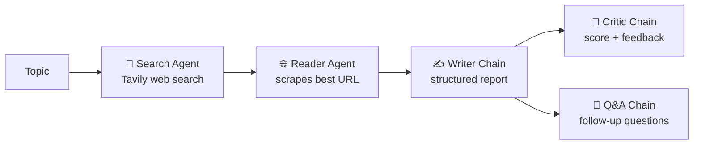

# 🔎 Deep Research Multi-Agent System

[](https://YOUR-APP-NAME.streamlit.app)

🌐 **Live demo:** (https://multiagentresearchtool.streamlit.app/)

A multi-agent research engine that takes any topic, searches the web, reads the best source, writes a structured report, and then critiques its own work. It ships with a **Streamlit web UI** and a **follow-up chat**, so you can ask questions about the finished research.

Built with [LangChain](https://www.langchain.com/), [Mistral AI](https://mistral.ai/) and [Tavily](https://tavily.com/).

---

## ✨ Features

- **4-agent pipeline**: Search → Read → Write → Critique
- **Live progress tracker** with per-step timings in the UI
- **Report quality score** extracted from the critic's review
- **Follow-up Q&A chat**: ask doubts about the researched topic, with answers grounded in the report and sources
- **Optional web search for follow-ups** when the answer isn't in the original research
- **Resilient by design**: timeouts, automatic retries, plain-language errors, and a "retry from failed step" button
- **Graceful degradation**: if the Read or Critique step fails, the pipeline still produces a report
- **Run history** in the sidebar, with downloadable reports (`.md`)
- Works from the **terminal** too (`pipeline.py`)

---

## 🧠 How it works



| Step | Component | What it does |
|------|-----------|--------------|
| 1 | Search agent | Uses the `web_search` tool (Tavily, top 5 results) to find recent, relevant sources |
| 2 | Reader agent | Picks the most relevant URL and scrapes its text with the `scrap_url` tool |
| 3 | Writer chain | Writes a report: Introduction, Key Findings, Conclusion, Sources |
| 4 | Critic chain | Reviews the report and returns a score out of 10, strengths, improvements and a verdict |
| 5 | Q&A chain | Answers follow-up questions using the report, search results and scraped content as context |

---

## 📁 Project structure

```
Deep_research_multiagent_system/
├── agents.py          # LLM setup, agents, and writer / critic / Q&A chains
├── tools.py           # web_search (Tavily) and scrap_url (requests + BeautifulSoup)
├── pipeline.py        # Terminal version of the full pipeline
├── app.py             # Streamlit UI
├── requirements.txt   # Python dependencies
└── .gitignore
```

---

## 🚀 Getting started

### Prerequisites

- Python 3.10 or newer
- A [Mistral AI API key](https://console.mistral.ai/)
- A [Tavily API key](https://app.tavily.com/)

### 1. Clone the repository

```bash
git clone https://github.com/sahilkumarkesarwani/Deep_research_multiagent_system.git
cd Deep_research_multiagent_system
```

### 2. Create a virtual environment

```bash
python -m venv venv

# Windows
venv\Scripts\activate

# macOS / Linux
source venv/bin/activate
```

### 3. Install dependencies

```bash
pip install -r requirements.txt
```

### 4. Add your API keys

Create a file named `.env` in the project root:

```env
MISTRAL_API_KEY=your_mistral_api_key_here
TAVILY_API_KEY=your_tavily_api_key_here
```

> ⚠️ Never commit your `.env` file. Make sure it is listed in `.gitignore`.

---

## ▶️ Usage

### Web UI (recommended)

```bash
streamlit run app.py
```

Then open the local URL Streamlit prints (usually http://localhost:8501):

1. Type a research topic (or click an example)
2. Click **🚀 Run** and watch the four steps complete
3. Read the report, the critique and the sources in the tabs
4. Ask follow-up questions in the **💬 Ask about this research** chat at the bottom
5. Download the report as Markdown

### Terminal

```bash
python pipeline.py
```

Enter a topic when prompted. The output of each step is printed to the console.

---

## ⚙️ Configuration

**Model**: change it in `agents.py`:

```python
llm = ChatMistralAI(model="ministral-3b-2512", temperature=0)
```

A larger Mistral model generally gives better reports and answers.

**UI settings** (sidebar in the app):

| Setting | Purpose |
|---------|---------|
| Search text passed to reader | How much of the search output the reader agent sees when choosing a URL |
| Timeout per step | Maximum time a step may take before it is treated as failed |
| Show raw agent output | Reveals the raw search and scrape output in the Raw output tab |
| Web search for follow-ups | Lets the chat look up fresh information for each question |

**Constants** at the top of `app.py`: `MAX_RETRIES`, `MAX_HISTORY`, `MAX_Q_LEN`, `MAX_CONTEXT_CHARS`, `MAX_TURNS`, `REQUIRED_KEYS`.

---

## ☁️ Deploy your own

You can host your own copy for free on [Streamlit Community Cloud](https://share.streamlit.io):

1. Fork this repository.
2. On Streamlit Community Cloud, click **Create app** and select your fork, the `main` branch and `app.py` as the main file.
3. Open **Advanced settings → Secrets** and add your keys:

   ```toml
   MISTRAL_API_KEY = "your_mistral_api_key_here"
   TAVILY_API_KEY = "your_tavily_api_key_here"
   ```

4. Click **Deploy**.

---

## 🛠️ Tech stack

| Purpose | Tool |
|---------|------|
| Agent framework | LangChain (`create_agent`, prompts, output parsers) |
| LLM | Mistral AI via `langchain-mistralai` |
| Web search | Tavily (`tavily-python`) |
| Scraping | `requests` + `beautifulsoup4` |
| UI | Streamlit |
| Config | `python-dotenv` |

---

## ⚠️ Known limitations

- The Reader agent scrapes **one** URL (first 3,000 characters), so the depth of research depends on that single page.
- Some sites block scrapers or load content with JavaScript, in which case scraping returns little or nothing. The app then writes the report from search results alone.
- With a small model, report quality and the critic's score can vary between runs.
- Run history and chats are stored in memory and are lost when the Streamlit session ends.
- Always verify important claims against the cited sources.

---

## 🗺️ Roadmap

- [ ] Scrape and summarize multiple sources
- [ ] Stream agent output token by token
- [ ] Export reports as PDF / DOCX
- [ ] Persist history to disk or a database
- [ ] Suggested follow-up questions
- [ ] Model selection from the UI

---

## 🤝 Contributing

Contributions are welcome. Fork the repo, create a feature branch, and open a pull request.

```bash
git checkout -b feature/your-feature
git commit -m "Add your feature"
git push origin feature/your-feature
```

---

## 📄 License

No license has been specified yet. Add a `LICENSE` file (for example MIT) to let others use and contribute to the project.

---

## 👤 Author

**Sahil Kumar Kesarwani**
GitHub: [@sahilkumarkesarwani](https://github.com/sahilkumarkesarwani)